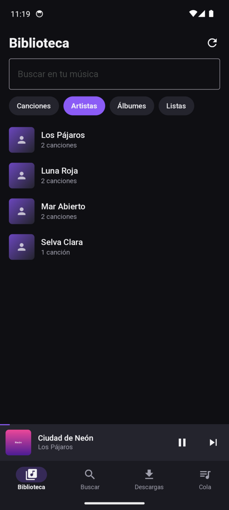
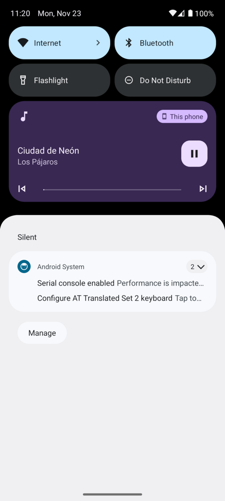

<div align="center">


<br>

**Reproductor de música liviano para Android, hecho en Rust.**
Tu biblioteca, un buscador rápido y descargas desde YouTube, Spotify y Apple Music en una sola app.

<br>

<a href="https://github.com/Maurezg7/Tein/raw/main/release/Tein.apk">
  
</a>

<br><br>


</div>

---

## Capturas

<div align="center">
  
  
  
  
  
</div>

## Funciones

<table>
<tr>
<td width="50%" valign="top">

### Reproductor
- Play / pausa, anterior / siguiente y barra de progreso
- Volumen, aleatorio y repetir (todo / una)
- Cola editable: reproducir a continuación, agregar, quitar
- Segundo plano con notificación y pantalla de bloqueo
- Controles de auriculares y pausa al desconectarlos

</td>
<td width="50%" valign="top">

### Biblioteca
- MP3, M4A/AAC, FLAC, OGG y WAV
- Vistas por canciones, artistas, álbumes y listas
- Buscador instantáneo en tu música
- Favoritas y listas de reproducción propias
- Portadas y etiquetas leídas de los archivos

</td>
</tr>
<tr>
<td width="50%" valign="top">

### Descargas
- Buscá en YouTube y bajá con un toque
- Pegá links de videos o playlists de YouTube
- Links de Spotify y Apple Music: canción, álbum o playlist
- **Playlists completas** (también de más de 100 temas) con **Bajar todo**
- Cada playlist se guarda en su carpeta `Música/Tein/<playlist>` y se crea como lista en la app
- Archivos M4A con título, artista y portada
- Se guardan en `Música/Tein` y aparecen solas en la biblioteca

</td>
<td width="50%" valign="top">

### Liviana
- Núcleo nativo en Rust, sin Electron ni WebView
- APK de 21 MB y arranque inmediato
- Sin cuentas, sin anuncios, sin rastreo
- Todo se guarda en el teléfono

</td>
</tr>
</table>

> Spotify y Apple Music protegen su audio con DRM. Tein lee los datos públicos del link (título y artista) y descarga el mismo tema desde YouTube.

## Instalación

1. Descargá **[Tein.apk](https://github.com/Maurezg7/Tein/raw/main/release/Tein.apk)** desde el celular.
2. Abrilo y aceptá *Instalar apps desconocidas* si Android lo pide.
3. Dale permiso de música y notificaciones al abrir Tein.

El APK es para celulares de 64 bits (arm64), que son casi todos los modelos actuales. Requiere Android 8.0 o superior.

## Compilar

Requisitos: Rust, Android SDK (platform 34 y build-tools 34), **Android NDK r30** (`30.0.16248370`), Java 17 y `cargo-ndk`.

```bash
rustup target add aarch64-linux-android x86_64-linux-android
cargo install cargo-ndk
export ANDROID_HOME=~/android-sdk
export ANDROID_NDK_HOME=$ANDROID_HOME/ndk/30.0.16248370

./build-apk.sh              # arm64-v8a + x86_64 (emulador)
./build-apk.sh arm64-v8a    # solo celulares, APK más chico
```

El APK queda en `target/apk/tein.apk`. Para instalarlo: `adb install -r target/apk/tein.apk`.
También se puede compilar con Gradle: `cd android && ./gradlew assembleRelease`.

<details>
<summary>Notas de compilación</summary>

- Con NDK anteriores a r30 la app compila pero se cierra al abrir (`cannot locate symbol __hash_memory`).
- Slint usa Skia en Android y no hay binarios precompilados de Skia para `armeabi-v7a`, por eso no se incluye esa arquitectura.

</details>

## Desarrollo en PC

```bash
cargo run --bin tein-desktop
cargo test --lib                       # tests offline
cargo test --lib -- --include-ignored  # incluye tests de red
```

## Hecho con

| | |
|---|---|
| Interfaz | [Slint](https://slint.dev) |
| Audio | [Rodio](https://github.com/RustAudio/rodio) |
| Etiquetas y portadas | [Lofty](https://github.com/Serial-ATA/lofty-rs) |
| Red | [ureq](https://github.com/algesten/ureq) + rustls |
| Android | NativeActivity + servicio de reproducción en Java |

## Licencia

[MIT](LICENSE)

<div align="center">
<br>

</div>
