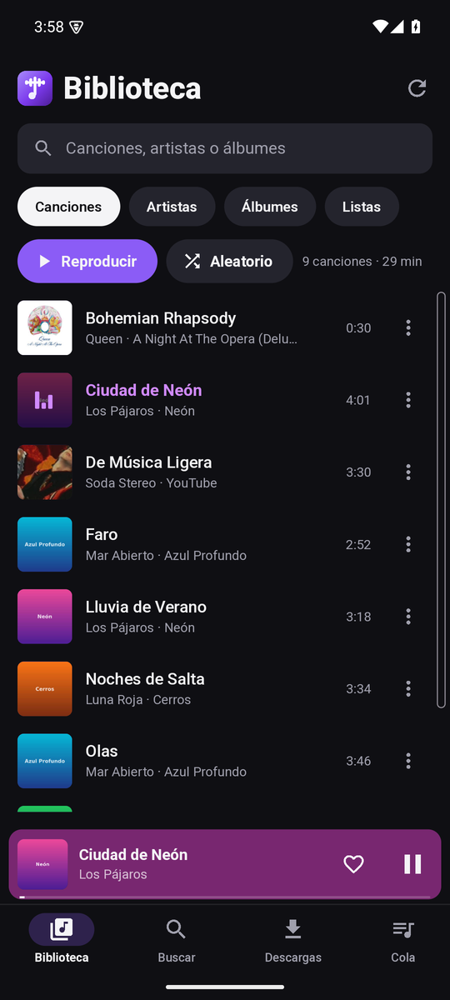

<div align="center">


<br>

**Reproductor de música liviano para Android, hecho en Rust.**
Tu biblioteca, un buscador rápido y descargas desde YouTube, Spotify y Apple Music en una sola app.

<br>

<a href="https://github.com/Maurezg7/Tein/raw/main/release/Tein.apk">
  
</a>

<br><br>


</div>

---

## Capturas

<div align="center">
  
  
  
  
  
</div>

## Funciones

<table>
<tr>
<td width="50%" valign="top">

### Reproductor
- Play / pausa, anterior / siguiente y barra de progreso
- Volumen, aleatorio y repetir (todo / una)
- Cola editable: reproducir a continuación, agregar, quitar
- Segundo plano con notificación y pantalla de bloqueo
- Controles de auriculares y pausa al desconectarlos

</td>
<td width="50%" valign="top">

### Biblioteca
- MP3, M4A/AAC, FLAC, OGG y WAV
- Vistas por canciones, artistas, álbumes y listas
- Buscador instantáneo en tu música
- Favoritas y listas de reproducción propias
- Portadas y etiquetas leídas de los archivos
- **Completar datos y portada**: busca título, artista, álbum, año y portada y los guarda en el archivo (una canción o un artista/álbum/lista entero)

</td>
</tr>
<tr>
<td width="50%" valign="top">

### Descargas
- Buscá en YouTube y bajá con un toque
- Pegá links de videos o playlists de YouTube
- Links de Spotify y Apple Music: canción, álbum o playlist
- **Playlists completas** (también de más de 100 temas) con **Bajar todo**
- Cada playlist se guarda en su carpeta `Música/Tein/<playlist>` y se crea como lista en la app
- Archivos M4A con título, artista y portada
- Se guardan en `Música/Tein` y aparecen solas en la biblioteca
- Si YouTube corta una descarga (403), sigue con otro cliente desde donde quedó

</td>
<td width="50%" valign="top">

### Liviana
- Núcleo nativo en Rust, sin Electron ni WebView
- APK de 37 MB (32 y 64 bits en uno) y arranque inmediato
- Sin cuentas, sin anuncios, sin rastreo
- Todo se guarda en el teléfono

</td>
</tr>
</table>

> Spotify y Apple Music protegen su audio con DRM. Tein lee los datos públicos del link (título y artista) y descarga el mismo tema desde YouTube.

### Completar datos y portadas

Tocá **⋮** en una canción (o mantené un artista, álbum o lista) y elegí **Completar datos y portada**. Tein usa el nombre del archivo o las etiquetas que ya tenga, limpia cosas como "(Official Video)" y busca en:

| Fuente | Qué aporta | Clave |
|---|---|---|
| [iTunes Search](https://performance-partners.apple.com/search-api) | Título, artista, álbum, año y portada 600×600 | No |
| [Deezer](https://developers.deezer.com/api) | Álbum y portada grande | No |
| [MusicBrainz](https://musicbrainz.org) + [Cover Art Archive](https://coverartarchive.org) | Datos del lanzamiento original y portada | No |
| [AcoustID](https://acoustid.org) | Reconoce la canción **por el sonido** (huella Chromaprint) | Sí |

El reconocimiento por sonido se usa cuando el nombre no alcanza (por ejemplo `audio_123.mp3`). Se activa compilando con una clave gratuita de AcoustID: `ACOUSTID_KEY=tu_clave ./build-apk.sh`.

En Android 11 o superior, para modificar canciones que no bajó Tein, la app abre el permiso **Acceso a todos los archivos** la primera vez. Activalo y volvé a tocar **Completar datos y portada**.

## Instalación

1. Descargá **[Tein.apk](https://github.com/Maurezg7/Tein/raw/main/release/Tein.apk)** desde el celular.
2. Abrilo y aceptá *Instalar apps desconocidas* si Android lo pide.
3. Dale permiso de música y notificaciones al abrir Tein.

## Compatibilidad

Tein funciona en **Android 8.0 (Oreo) hasta Android 15**, en celulares de **32 y 64 bits**. El APK trae las dos versiones (`armeabi-v7a` y `arm64-v8a`) y Android instala la que corresponde.

El **Samsung Galaxy A13** es compatible en todas sus versiones (4G y 5G), con Android 12, 13 o 14. Varios A13 vienen con Android de 32 bits aunque el procesador sea de 64; por eso el APK incluye la versión de 32 bits.

| Android | Versión | Estado |
|---|---|---|
| 8.0 – 8.1 | Oreo (API 26–27) | ✅ Probado en emulador (Android 8.0) |
| 9 – 11 | Pie, 10, 11 | ✅ Probado en emulador (Android 11, versión de 32 bits) |
| 12 – 13 | API 31–33 | ✅ Probado en emulador (Android 12) |
| 14 – 15 | API 34–35 | ✅ Probado en emulador (Android 15) |
| 7.x o anterior | — | ❌ No soportado |

**Celulares parecidos al A13 que funcionan:** Galaxy A02, A03, A03 Core, A04, A04s, A05s, A12, A14, A15, A23, A24, A25, A32, A33, A34, M13, M14, M23 y en general cualquier Samsung, Motorola, Xiaomi o Redmi con Android 8.0 o superior.

No funciona en celulares x86 de 32 bits ni con Android 7 o anterior.


En Android 11 o superior las descargas van a `Música/Tein`. Si el sistema no deja escribir ahí, Tein las guarda en la carpeta propia de la app y igual aparecen en la biblioteca.

## Compilar

Requisitos: Rust, Android SDK (platform 34 y build-tools 34), **Android NDK r30** (`30.0.16248370`), Java 17 y `cargo-ndk`.

```bash
rustup target add aarch64-linux-android armv7-linux-androideabi x86_64-linux-android
cargo install cargo-ndk
export ANDROID_HOME=~/android-sdk
export ANDROID_NDK_HOME=$ANDROID_HOME/ndk/30.0.16248370

./build-apk.sh                      # arm64-v8a + armeabi-v7a (celulares)
./build-apk.sh arm64-v8a x86_64     # 64 bits + emulador
```

El APK queda en `target/apk/tein.apk`. Para instalarlo: `adb install -r target/apk/tein.apk`.
También se puede compilar con Gradle: `cd android && ./gradlew assembleRelease`.

<details>
<summary>Notas de compilación</summary>

- Con NDK anteriores a r30 la app compila pero se cierra al abrir (`cannot locate symbol __hash_memory`).
- Slint usa Skia en Android y no hay binarios precompilados de Skia para `armeabi-v7a`. El script compila Skia desde el código para esa arquitectura (tarda unos minutos la primera vez y necesita `ninja` y `python3`) y usa el `libclang` del NDK para generar los bindings.

</details>

## Desarrollo en PC

```bash
cargo run --bin tein-desktop
cargo test --lib                       # tests offline
cargo test --lib -- --include-ignored  # incluye tests de red
```

## Hecho con

| | |
|---|---|
| Interfaz | [Slint](https://slint.dev) |
| Audio | [Rodio](https://github.com/RustAudio/rodio) |
| Etiquetas y portadas | [Lofty](https://github.com/Serial-ATA/lofty-rs) |
| Huella de audio | [rusty-chromaprint](https://github.com/darksv/rusty-chromaprint) |
| Red | [ureq](https://github.com/algesten/ureq) + rustls |
| Android | NativeActivity + servicio de reproducción en Java |

## Licencia

[MIT](LICENSE)

<div align="center">
<br>

</div>
