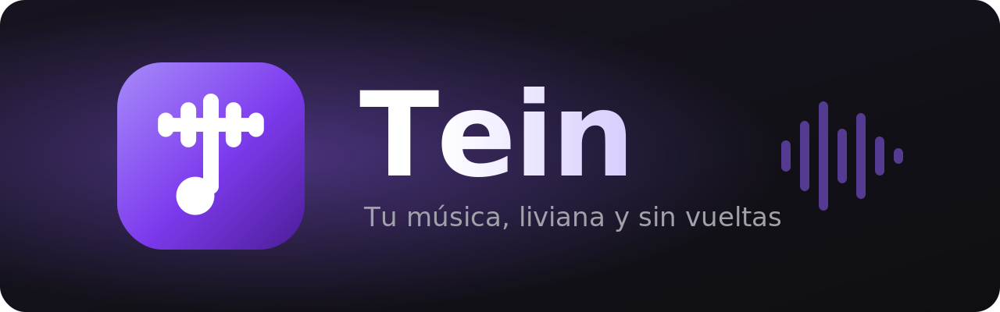
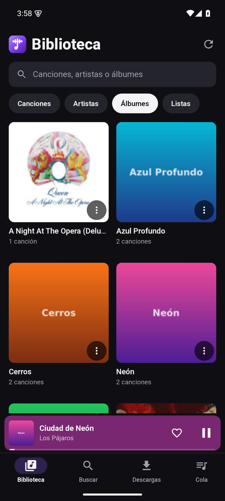
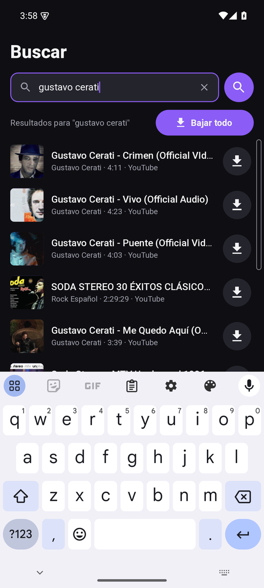
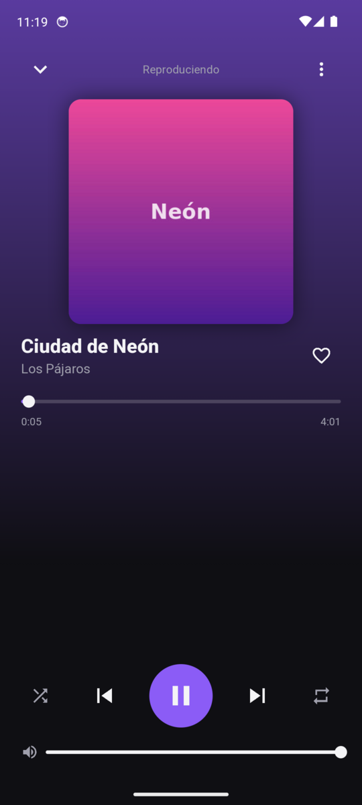
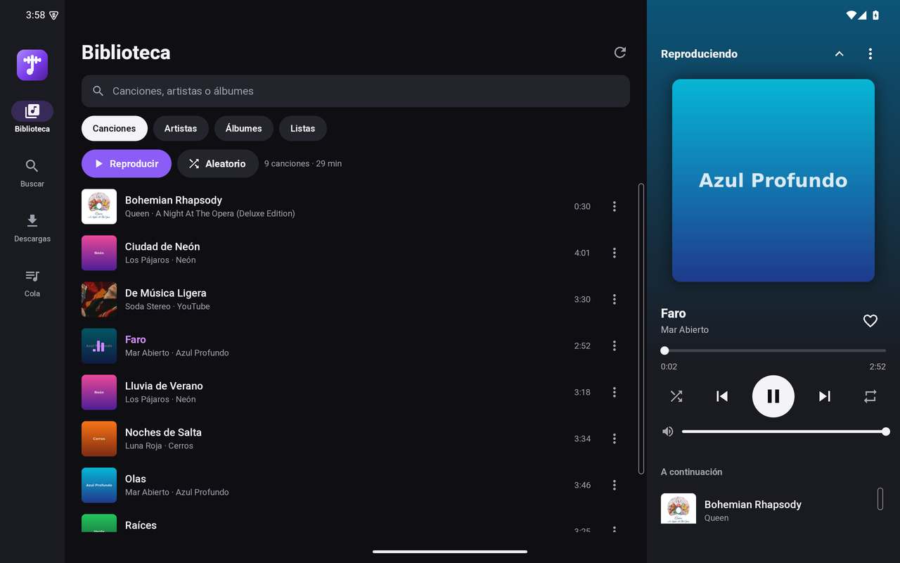
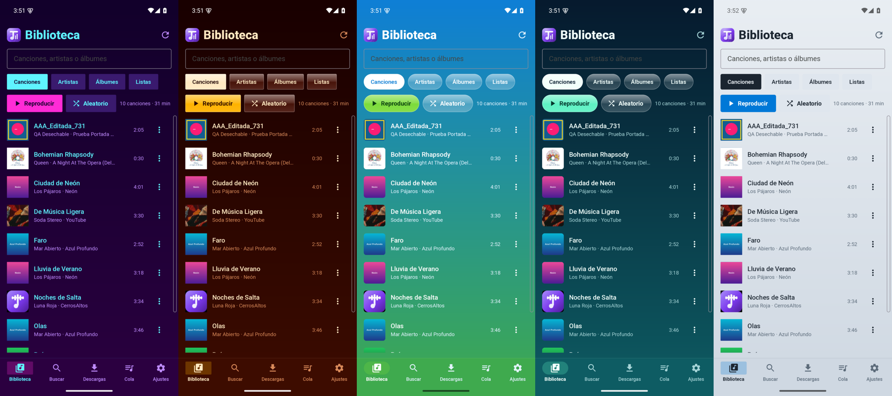
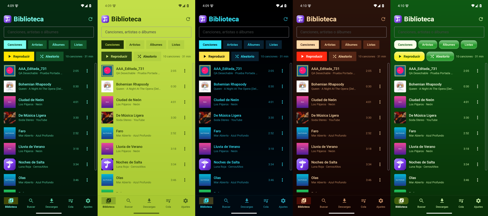
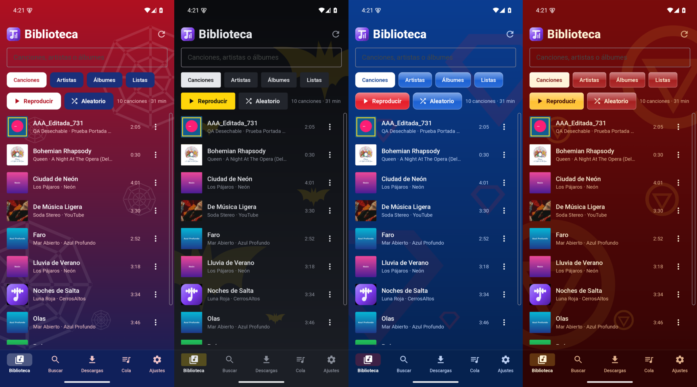
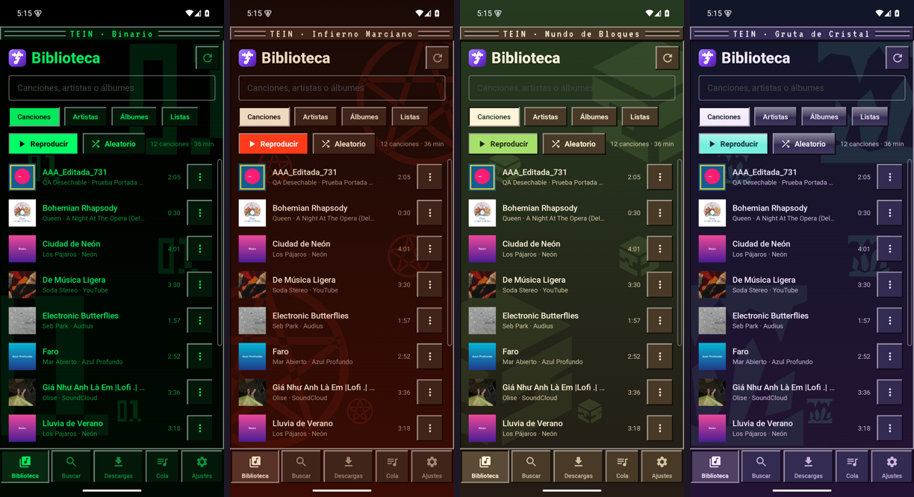
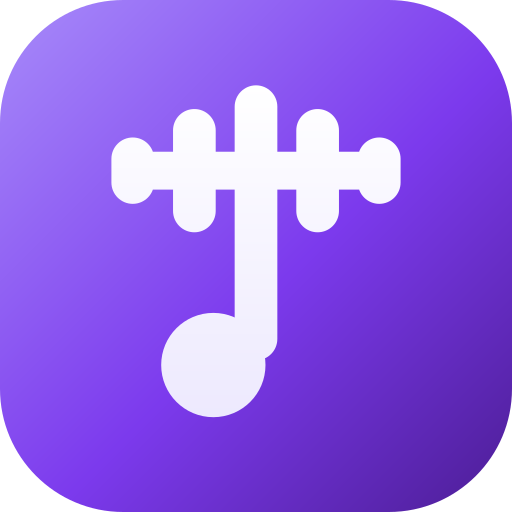

<div align="center">



<br>

**Reproductor de música para Android, Windows y Linux, hecho en Rust.**
Tu biblioteca, un buscador por plataforma y descargas de música en una sola app. Admite enlaces de YouTube, SoundCloud, Audius, Spotify y Apple Music.

<br>

<a href="https://github.com/Maurezg7/Tein/raw/main/release/Tein.apk">
  
</a>
<a href="https://github.com/Maurezg7/Tein/releases/tag/desktop-v1.4.0">Descargar para PC</a>

<br><br>


</div>

---

## Capturas

<div align="center">
  
  
  
  
  
  <br><br>
  
  <br>
  
  <br>
  
  
  
  <br><sub>En tablets: barra lateral y reproductor siempre visible al lado de tu música.</sub>
</div>

## Funciones

<table>
<tr>
<td width="50%" valign="top">

### Reproductor
- Interfaz adaptable: celulares chicos y grandes, tablets en vertical y horizontal
- Colores del reproductor tomados de la portada
- Play / pausa, anterior / siguiente y barra de progreso
- Volumen, aleatorio y repetir (todo / una)
- Cola editable: reproducir a continuación, agregar, quitar
- Segundo plano con controles en la notificación y la pantalla de bloqueo. En Android 10 o superior, expandí el control multimedia y arrastrá la barra para saltar a otro segundo (la presentación depende del teléfono).
- Controles de auriculares y pausa al desconectarlos
- Si otra app reproduce audio o video, Tein se pausa, espera y retoma sola desde el mismo segundo cuando la otra termina
- **Ecualizador** de 5 bandas con presets (Graves, Agudos, Rock, Pop, Voz, Electrónica) y ajuste manual
- **69 diseños en Ajustes**. De ellos, **40 son skins completas** al estilo Winamp: cambian los paneles, botones, biseles y barras de navegación, además del fondo. El mini reproductor tiene display LCD y espectro animado. Comparten la navegación de Tein: no importan archivos `.wsz`.
  - Colores: Violeta, Océano, Esmeralda, Atardecer, Rosa y Negro puro
  - Estilo Winamp: Winamp Clásico, Winamp Bento, Amp Matrix, Amp Neón, Amp Lava y Amp Hielo (bordes rectos y colores fosforescentes)
  - Inspirados en skins del [Winamp Skin Museum](https://skins.webamp.org/): Amp Circuito, Amp Búnker, Amp 8-bit, Amp Terminal, Amp Infierno, Amp Glow, Amp Denim, Amp Biomecánico, Amp Refresco, Amp Aventura y Amp Acero
  - Temáticos: Sega 16-bit, Windows XP, XP Luna, Retro 70s, Retro Synthwave, Dark Fantasy, Light Fantasy, Xenomorfo, Nostromo, Terror y Terror Niebla
  - Superhéroes: Héroe Arácnido, Caballero Nocturno, Hombre de Acero, Armadura de Hierro, Titán Esmeralda, Capitán Escudo, Velocista y Amazona
  - Frutiger: Frutiger Aero, Frutiger Eco, Frutiger Aurora, Aero Oscuro y Frutiger Metro (degradados, botones con brillo de vidrio y un tema claro)
  - Código y terror: Binario, Horror Cósmico, Abismo Antiguo e Infierno Marciano
  - Juegos, consolas y animación: Fontanero 8-bit, Laberinto Arcade, Robot Azul, Erizo Veloz, Anillo Espacial, Subsuelo Pixel, Vice Neón, Familia Amarilla, Consola Azul 2000, Consola Verde, Cartucho 64, Marsupial Tropical y Supervivencia Gótica
  - Series animadas: Reino Flotante (islas de aventura), Casete del Parque y Barrio de Papel (collage)
  - Mundos de juego: Mundo de Bloques (tierra y pasto, inspirado en Minecraft) y Gruta de Cristal (cavernas y gemas, inspirado en Terraria). Las figuras son originales; no se usan personajes ni logos de las franquicias.

</td>
<td width="50%" valign="top">

### Biblioteca
- MP3, M4A/AAC, FLAC, OGG y WAV
- Vistas por canciones, artistas, álbumes y listas
- Buscador instantáneo en tu música
- Favoritas y listas de reproducción propias
- Menú **⋮** en la biblioteca, la cola y el reproductor: editá título, artista y álbum sin perder la portada, o elegí **Eliminar archivo…** y confirmá. **Quitar de la cola** no borra el archivo.
- Editá con libertad: nombre y artista de un álbum entero, nombre de un artista o de una lista, y la **foto de portada** de canciones, álbumes, artistas y listas con una imagen de tu galería
- Portadas en todas las listas y cuadrícula de álbumes, artistas y listas
- **Completar datos y portada**: busca título, artista, álbum, año y portada y los guarda en el archivo (una canción o un artista/álbum/lista entero)

</td>
</tr>
<tr>
<td width="50%" valign="top">

### Descargas
- Buscá en YouTube y bajá con un toque
- En **Buscar**, elegí **SoundCloud** o **Audius** para buscar por nombre, o pegá un enlace público. SoundCloud solo descarga MP3 que el autor distribuye en su feed RSS; para pistas de solo escucha, usá el botón de enlace para abrir SoundCloud. Las listas muestran las pistas visibles en su página pública.
- Audius muestra pistas con descarga pública habilitada, sin acceso restringido. Se guarda el formato original si es compatible. No se convierten streams en archivos descargables.
- Pegá links de videos o playlists de YouTube. Aunque el enlace sea largo, el botón **Buscar** queda visible y se envía el texto completo.
- Links de Spotify y Apple Music: canción, álbum o playlist
- **Bajar todo** en resultados de una colección. YouTube y Spotify admiten listas de más de 100 temas; la disponibilidad depende de la plataforma.
- Cada playlist se guarda en su carpeta `Música/Tein/<playlist>` y se crea como lista en la app
- M4A de YouTube, MP3 de SoundCloud y formatos compatibles de Audius, con título, artista y portada si la fuente la ofrece
- Antes de la primera descarga Tein pregunta dónde guardar: memoria interna, **tarjeta SD** u otra carpeta. Se cambia cuando quieras en **Ajustes → Cambiar carpeta**
- Por defecto se guardan en `Música/Tein` y aparecen solas en la biblioteca
- Si el proveedor está saturado, Tein frena las consultas a ese host. Permite hasta 512 descargas por tanda y transfiere una por vez; tu biblioteca local no necesita Internet.
- Si YouTube corta una descarga (403), sigue con otro cliente desde donde quedó

</td>
<td width="50%" valign="top">

### Liviana
- Núcleo nativo en Rust, sin Electron ni WebView
- **Peso de descarga:** el APK firmado de **1.4.0 pesa 21,23 MB** (21.231.048 bytes; 20,25 MiB), frente a 41,17 MB en 1.3.0: **48,4 % menos**. Conserva ARM de 32 y 64 bits. Las bibliotecas van comprimidas y Android extrae solo la arquitectura que usa al instalar; el espacio instalado es distinto.
- Sin cuentas, sin anuncios, sin rastreo
- Todo se guarda en el teléfono

</td>
</tr>
</table>

> Spotify y Apple Music: Tein lee metadatos públicos y busca una coincidencia en YouTube. No extrae audio con DRM ni garantiza que la grabación coincida. Descargá únicamente contenido que tengas permiso de guardar.

### Completar datos y portadas

Tocá **⋮** en una canción, artista, álbum o lista y elegí la opción para completar los datos y la portada. Tein usa el nombre del archivo o las etiquetas que ya tenga, limpia cosas como "(Official Video)" y busca en:

| Fuente | Qué aporta | Clave |
|---|---|---|
| [iTunes Search](https://performance-partners.apple.com/search-api) | Título, artista, álbum, año y portada 600×600 | No |
| [Deezer](https://developers.deezer.com/api) | Álbum y portada grande | No |
| [MusicBrainz](https://musicbrainz.org) + [Cover Art Archive](https://coverartarchive.org) | Datos del lanzamiento original y portada | No |
| [AcoustID](https://acoustid.org) | Reconoce la canción **por el sonido** (huella Chromaprint) | Sí |

El reconocimiento por sonido se usa cuando el nombre no alcanza (por ejemplo `audio_123.mp3`). Se activa compilando con una clave gratuita de AcoustID: `ACOUSTID_KEY=tu_clave ./build-apk.sh`.

En Android 11 o superior, si Android impide editar o borrar un archivo de otra app, Tein abre **Acceso a todos los archivos**. Si decidís habilitarlo, volvé a Tein y repetí la operación.

[Revisión de seguridad de la versión 1.4: correcciones, permisos y dependencias](docs/revision-1.4.md).

## Instalación en PC

La [edición de escritorio 1.4.0](https://github.com/Maurezg7/Tein/releases/tag/desktop-v1.4.0) es para **PC Intel/AMD de 64 bits**. Usá el paquete de tu sistema; no necesitás Rust.

| Sistema | Descarga | Desde la carpeta de descarga |
|---|---|---|
| Windows 10/11 x64 | [ZIP portátil](https://github.com/Maurezg7/Tein/releases/download/desktop-v1.4.0/Tein-1.4.0-windows-x64.zip) | Extraé el ZIP y abrí **Tein.exe**. No requiere administrador; no tiene firma Authenticode. |
| Debian 12 o posterior | [.deb](https://github.com/Maurezg7/Tein/releases/download/desktop-v1.4.0/tein_1.4.0-1_amd64.deb) | `sudo apt install ./tein_1.4.0-1_amd64.deb` |
| Fedora | [.rpm](https://github.com/Maurezg7/Tein/releases/download/desktop-v1.4.0/tein-1.4.0-1.x86_64.rpm) | `sudo dnf install ./tein-1.4.0-1.x86_64.rpm` |
| Arch Linux | [.pkg.tar.zst](https://github.com/Maurezg7/Tein/releases/download/desktop-v1.4.0/tein-1.4.0-1-x86_64.pkg.tar.zst) | `sudo pacman -U ./tein-1.4.0-1-x86_64.pkg.tar.zst` |
| Void Linux **glibc** | [.xbps](https://github.com/Maurezg7/Tein/releases/download/desktop-v1.4.0/tein-1.4.0_1.x86_64.xbps) | `xbps-rindex -a ./tein-1.4.0_1.x86_64.xbps` y luego `sudo xbps-install --repository="$PWD" tein` |

**Primer uso:** Tein escanea la carpeta Música de tu cuenta (en Linux respeta `XDG_MUSIC_DIR`) y la carpeta elegida en **Ajustes → Cambiar carpeta**. Incluye el reproductor, las listas, el buscador, las descargas, el ecualizador y las skins de Android. En Linux aparece en el menú de aplicaciones y también se abre con `tein`. Los controles de notificación y de pantalla bloqueada de Android no se trasladan al escritorio.

Los paquetes de Linux necesitan una sesión gráfica y una salida de audio ALSA (puede ser PipeWire o PulseAudio con compatibilidad ALSA). Instalan Zenity para los selectores de archivos. Si el controlador gráfico no ofrece OpenGL, probá `SLINT_BACKEND=winit-software tein`. No son para ARM ni para Void musl. Para verificar la descarga, compará su SHA-256 con **SHA256SUMS** en la release.

## Instalación en Android

1. Descargá **[Tein.apk](https://github.com/Maurezg7/Tein/raw/main/release/Tein.apk)** desde el celular.
2. Abrilo y aceptá *Instalar apps desconocidas* si Android lo pide.
3. Dale permiso de música y notificaciones al abrir Tein.

## Compatibilidad

Tein funciona en **Android 8.0 (Oreo) hasta Android 15**, en celulares de **32 y 64 bits**. El APK trae las dos versiones (`armeabi-v7a` y `arm64-v8a`) y Android instala la que corresponde.

El **Samsung Galaxy A13** es un dispositivo objetivo, no un teléfono probado físicamente. Algunos equipos tienen sistema de 32 bits aunque el procesador sea de 64; por eso el APK incluye ambas arquitecturas.

| Android | Versión | Estado |
|---|---|---|
| 8.0 – 8.1 | Oreo (API 26–27) | ✅ Probado en emulador (Android 8.0) |
| 9 – 11 | Pie, 10, 11 | ✅ Probado en emulador (Android 11, versión de 32 bits) |
| 12 – 13 | API 31–33 | ✅ Probado en emulador (Android 12) |
| 14 – 15 | API 34–35 | ✅ Probado en emulador (Android 15) |
| 7.x o anterior | — | ❌ No soportado |

Para otros celulares o tablets, comprobá la versión de Android y la arquitectura del sistema. Las pruebas de emulador no certifican cada modelo ni la escritura en una tarjeta SD física.

No funciona en celulares x86 de 32 bits ni con Android 7 o anterior.


Si usás la ubicación predeterminada, Tein intenta guardar en `Música/Tein`. Si Android no deja escribir ahí, usa su carpeta propia. También podés elegir otra ubicación en **Ajustes → Cambiar carpeta**.

## Compilar

Requisitos: Rust, Android SDK (platform 34 y build-tools 34), **Android NDK r30** (`30.0.16248370`), Java 17 y `cargo-ndk`.

```bash
rustup target add aarch64-linux-android armv7-linux-androideabi x86_64-linux-android
cargo install cargo-ndk
export ANDROID_HOME=~/android-sdk
export ANDROID_NDK_HOME=$ANDROID_HOME/ndk/30.0.16248370

./build-apk.sh                      # arm64-v8a + armeabi-v7a (celulares)
./build-apk.sh arm64-v8a x86_64     # 64 bits + emulador
```

El APK queda en `target/apk/tein.apk`. Para instalarlo: `adb install -r target/apk/tein.apk`.
También se puede compilar con Gradle: `cd android && ./gradlew assembleRelease`.

<details>
<summary>Notas de compilación</summary>

- Con NDK anteriores a r30 la app compila pero se cierra al abrir (`cannot locate symbol __hash_memory`).
- Slint usa Skia en Android y no hay binarios precompilados de Skia para `armeabi-v7a`. El script compila Skia desde el código para esa arquitectura (tarda unos minutos la primera vez y necesita `ninja` y `python3`) y usa el `libclang` del NDK para generar los bindings.
- Sin un almacén de release se usa una firma de desarrollo, que no permite actualizar la app oficial. Para publicar, usá el almacén existente con `TEIN_KEYSTORE`, `TEIN_KEYSTORE_PASSWORD` y, si corresponde, `TEIN_KEY_ALIAS` y `TEIN_KEY_PASSWORD`. No guardes la clave ni sus contraseñas en git.

</details>

## Desarrollo en PC

```bash
cargo run --bin tein-desktop
cargo test --lib                       # tests offline
TEIN_TEST_AUDIO=/ruta/a/ejemplo.m4a cargo test --lib -- --include-ignored --test-threads=1
```

Para generar paquetes y probar una instalación aislada, consultá la [guía de empaquetado](packaging/desktop/README.md).

## Hecho con

| | |
|---|---|
| Interfaz | [Slint](https://slint.dev) |
| Audio | [Rodio](https://github.com/RustAudio/rodio) |
| Etiquetas y portadas | [Lofty](https://github.com/Serial-ATA/lofty-rs) |
| Huella de audio | [rusty-chromaprint](https://github.com/darksv/rusty-chromaprint) |
| Red | [ureq](https://github.com/algesten/ureq) + rustls |
| Android | NativeActivity + servicio de reproducción en Java |

## Licencia

[MIT](LICENSE)

La fuente [VT323](ui/fonts/VT323-OFL.txt), usada en los displays de las skins, tiene licencia SIL Open Font License.

<div align="center">
<br>

</div>
